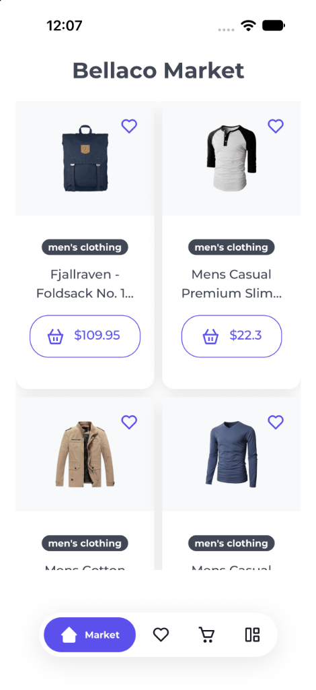
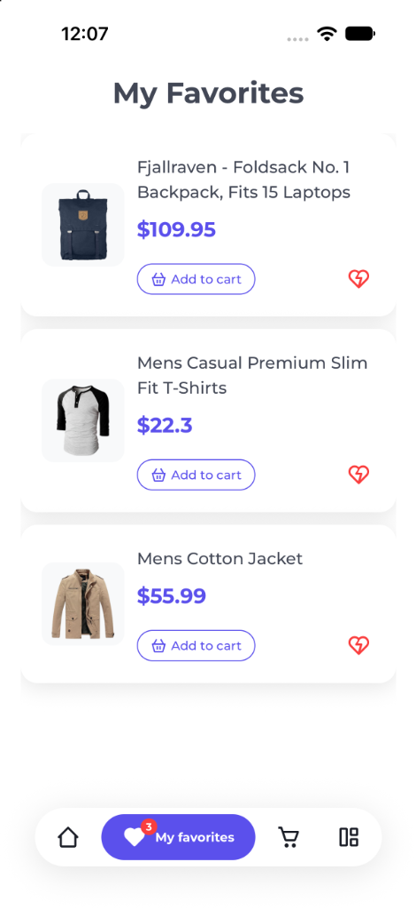
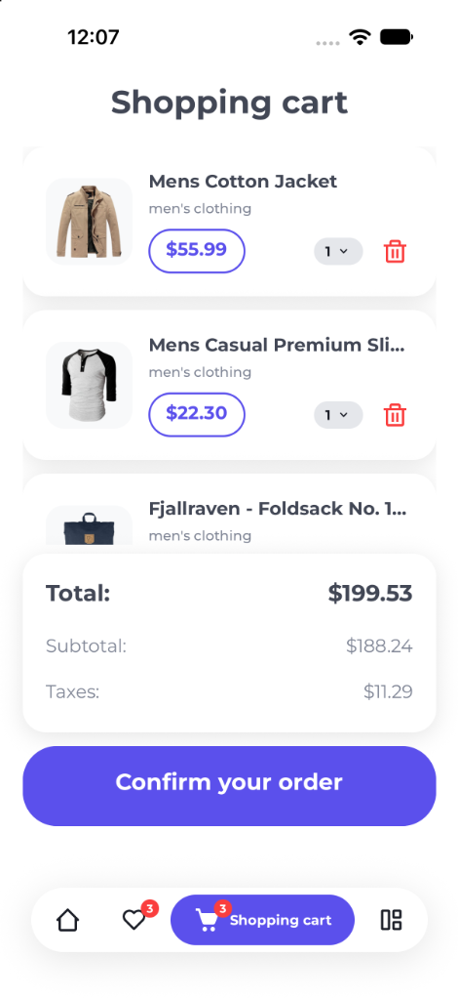

# 📱 Bellaco Market App


**Bellaco Market** is a modern, high-performance mobile e-commerce application crafted with **React Native 0.87+** and **TypeScript**. It demonstrates fluid user interfaces, atomic design architecture, centralized theme management, and robust global state handling.

---

## 📸 App Preview

|                                  Market Catalog                                  |                                   My Favorites                                    |                           Shopping Cart & Checkout                            |
| :------------------------------------------------------------------------------: | :-------------------------------------------------------------------------------: | :---------------------------------------------------------------------------: |
|  |  |  |

---

## ✨ Key Features

- **🛍️ Product Catalog (`Market`):**

  - Responsive multi-column grid layout with smooth scrolling.
  - Interactive product cards displaying badges, pricing, and category tags.
  - Instant favorite toggle and direct add-to-cart actions with live feedback.

- **❤️ Favorites Management (`My Favorites`):**

  - Dedicated screen displaying saved items with streamlined horizontal card layouts.
  - One-tap removal or instant transfer into the shopping cart.
  - Real-time tab bar badge synchronization reflecting total favorite items.

- **🛒 Shopping Cart & Checkout (`Shopping Cart`):**

  - Item listing with quantity indicators and deletion controls.
  - Dynamic real-time computation of **Subtotal**, **Taxes (6%)**, and **Total**.
  - Animated full-screen payment simulation via `LoaderUi` with automated cart wipe upon successful order confirmation.

- **🧩 Strict Modular Architecture:**
  - Clean separation following Atomic Design principles: `ui`, `layouts`, `templates`, and `screens`.
  - Centralized styling sheets and comprehensive TypeScript interfaces mirroring architectural layers.

---

## 🛠️ Tech Stack & Dependencies

### Core Framework & State Management

- **[React Native](https://reactnative.dev/) (v0.87.1)**: Core framework for cross-platform iOS & Android native development.
- **[React](https://react.dev/) (v19.2.3)**: UI component runtime.
- **[TypeScript](https://www.typescriptlang.org/) (v6.0.3)**: Static typing for maintainability, safety, and self-documenting code.
- **[Redux Toolkit](https://redux-toolkit.js.org/) (`@reduxjs/toolkit` & `react-redux`)**: Predictable global state management for favorites, cart items, and ordering.
- **[Redux Persist](https://github.com/rt2zz/redux-persist) & [MMKV](https://github.com/mrousavy/react-native-mmkv)**: High-speed, persistent key-value storage.

### Navigation & UI

- **[React Navigation](https://reactnavigation.org/) (`v7.x`)**:
  - `@react-navigation/native` & `@react-navigation/native-stack`
  - `@react-navigation/bottom-tabs` for floating pill tab bar navigation.
- **`react-native-safe-area-context` & `react-native-screens`**: Native layout edge-handling and screen memory optimization.
- **`react-native-vector-icons`**: Vector icon library powered by Boxicons.

---

## 💻 System Requirements

| Tool                   | Supported Platform                    | Download Link                                    |
| ---------------------- | ------------------------------------- | ------------------------------------------------ |
| **Visual Studio Code** | macOS / Windows / Linux               | [Download](https://code.visualstudio.com/)       |
| **Android Studio**     | macOS / Windows / Linux               | [Download](https://developer.android.com/studio) |
| **Xcode**              | macOS only                            | [Download](https://developer.apple.com/xcode/)   |
| **Node.js**            | `>= 22.11.0` (Recommended `v24.19.x`) | Via NVM (see below)                              |
| **Yarn**               | `v3.6.4`                              | Included in repository                           |

---

## 🚀 Installation & Setup

### 1. Node.js Environment

The repository includes a `.nvmrc` file specifying the recommended Node version (`24.19`):

```bash
# Apply version from .nvmrc
nvm use

# Or install if not available:
nvm install 24.19
nvm use 24.19
```

### 2. Install Dependencies

Install packages using Yarn (configured at version `3.6.4`):

```bash
yarn install
```

### 3. Install iOS CocoaPods (macOS only)

Link the native iOS dependencies:

```bash
cd ios && pod install && cd ..
```

---

## 🏃 Running the Application

1. **Start the Metro development server:**

   ```bash
   yarn start
   ```

2. **Launch the application on target device/simulator (in a separate terminal window):**

   ```bash
   # For iOS Simulator / Physical Device (macOS only)
   yarn ios

   # For Android Emulator / Physical Device
   yarn android
   ```

---
